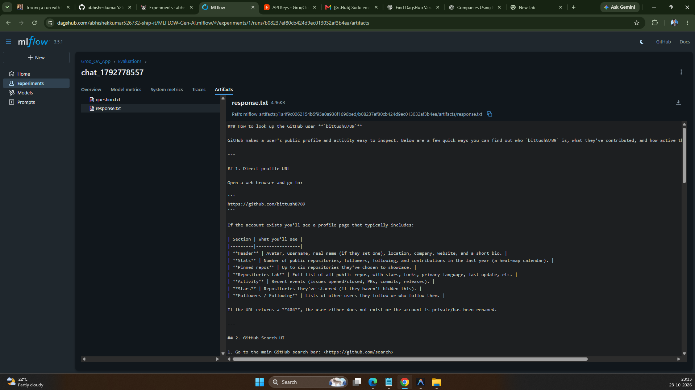

# MLFLOW Gen-AI Assistant

A fast Q&A web application built with **Streamlit** and powered by **Groq** using the **`openai/gpt-oss-120b`** model, integrated with **DagsHub MLflow** for experiment tracking and evaluation reporting.

---

## 🎯 Problem This Project Solves

1. **Slow LLM Latencies & High Costs**: Traditional cloud LLM APIs can be sluggish and expensive for real-time applications. By pairing Groq's LPU acceleration with the open-weight **GPT-OSS 120B** model, this project achieves sub-second, streaming responses at high token throughput.
2. **Lack of GenAI Tracking & Observability**: Most chat apps lack visibility into performance over time. This project integrates **MLflow with DagsHub Cloud** to track prompts, parameters, query latency, and output text automatically.
3. **Reproducible Model Evaluation**: Comparing model answers against ground truth is often unstandardized. This system includes automated benchmark evaluation tools that measure latency, length, and accuracy, exporting clean results into `eval.csv`.
4. **No Vendor Lock-In**: Seamlessly switch between different open models (`openai/gpt-oss-120b`, `llama-3.3-70b-versatile`, `llama-3.1-8b`, `mixtral-8x7b`) without rewriting your pipeline.

---

## ⚡ Features

- **Ultra-Fast Inference**: Streaming responses via Groq LPU.
- **Flagship 120B Model**: Powered by `openai/gpt-oss-120b` with multi-model support.
- **Interactive UI**: Clean Streamlit chat interface with latency metrics.
- **Evaluation & Reporting**: Benchmark runner with automated exports to `eval.csv`.
- **DagsHub MLflow Tracking**: Remote cloud experiment tracking and artifact logging.

---

## 📸 DagsHub MLflow Dashboard & Artifacts



*Tracking runs, parameters, metrics, and conversation artifacts (`question.txt`, `response.txt`) on DagsHub Cloud.*

---

## 🚀 Quick Start

### 1. Install Dependencies
```bash
python -m pip install -r requirements.txt
```

### 2. Configure Environment (`.env`)
Create a `.env` file from `.env.example`:
```dotenv
GROQ_API_KEY=your_groq_api_key
GROQ_MODEL=openai/gpt-oss-120b

DAGSHUB_REPO_OWNER=abhishekkumar526732-ship-it
DAGSHUB_REPO_NAME=MLFLOW-Gen-AI
DAGSHUB_USER_TOKEN=your_dagshub_token
```

### 3. Run the Streamlit App
```bash
python -m streamlit run app.py
```
Open **http://localhost:8501** in your browser.

---

## 🧪 Run Benchmark & Evaluation
Generate the `eval.csv` report and log metrics directly to DagsHub MLflow:
```bash
python test.py
```

---

## 📁 Project Structure

```text
├── app.py            # Streamlit Q&A application & evaluation UI
├── test.py           # CLI benchmark evaluation & DagsHub logging script
├── eval.csv          # Evaluation results and performance metrics
├── image.png         # DagsHub MLflow dashboard screenshot
├── requirements.txt  # Project Python dependencies
├── .env.example      # Environment variables template
└── README.md         # Documentation
```